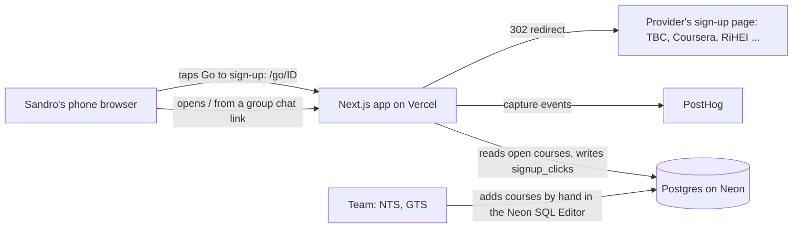

# Architecture

One diagram, one line of why per layer. The question each line answers is not "is this the best technology" but "can this team deploy it at a public URL by the Week 7 lab."

## The diagram

One public page and one redirect route. No accounts. The team adds courses in the Neon SQL Editor, so there is no admin screen in Sprint 1.

## The stack, one line per layer

| Layer | Choice | Why we can deploy it by Week 7 (who has done it before, or the free tier that makes it easy) |
|---|---|---|
| Hosting | Vercel | Neither of us has deployed before, so we follow the course guide step by step (`Lab-6/setup/SHIP-STACK-SETUP.md`); free Hobby plan, HTTPS and a URL in about ten minutes; NTS owns the account because the repo is his |
| App framework | Next.js (App Router, TypeScript) | The course reference stack, so every setup step and fix in the guide matches our code; server routes mean no separate backend |
| Database | Postgres on Neon | Hosted, free tier, nothing to run; two tables (`courses`, `signup_clicks`) are all Sprint 1 needs |
| Analytics | PostHog (wired on the first sprint evening, `setup/SHIP-STACK-SETUP.md`) | fixed for the course |
| Messages out (email, SMS, WhatsApp), if any step needs one | None | No step sends a message; alerts are on the cut list (`03-build/mvp-boundary.md`) |
| Sign-in, if any step needs one | None | Students never sign in; the team uses the Neon console |

**Layers we deliberately do not have in Sprint 1:** login, admin screen, messages out, file storage, background jobs, scraping.

## The journey through the stack

| Step | Layer that handles it | Event fired |
|---|---|---|
| 1 | Next.js page `/` reads `courses` where `closes_at` is today or later, newest first | `student_opens_course_list` (browser, on load, with `source` from `?src=`) |
| 2 | Same page; tapping a course opens its card | `student_opens_course_card` (browser, on tap) |
| 3 | Route `/go/[id]` inserts a `signup_clicks` row, then redirects to the course's `signup_url` | `student_opens_signup_page` (server, after the insert, `await posthog.flush()` before the redirect) |
| 4 | Share button on the card uses the phone's share sheet, or copies the link | `student_shares_course` (browser, after the share or copy succeeds) |
| 5 | Same page `/`; the phone remembers the time of the last visit in local storage and marks newer courses "New" | `student_returns_to_course_list` (browser, on load, only when there was a previous visit) |

## Secrets and data

- Secrets live in: `app/.env.local` (`DATABASE_URL`, `NEXT_PUBLIC_POSTHOG_KEY`, `NEXT_PUBLIC_POSTHOG_HOST`, `POSTHOG_KEY`, `POSTHOG_HOST`) and in Vercel's environment variables. The root `.gitignore` lists `.env` and `.env.*` (checked before the first commit of `app/`); `app/.env.example` lists the names with empty values.
- Personal data we store, and where: none. `signup_clicks` holds a course id, the anonymous `student_id` and a timestamp. No names, emails or phone numbers anywhere.
- The one thing in this design most likely to break on deploy day: the server event in `/go/[id]`. The redirect works even if the event is lost, so a missing `POSTHOG_KEY` in Vercel or a missing `flush()` fails silently. First check in the Week 7 lab: tap three courses on a phone, then compare `signup_clicks` rows with the PostHog count.
